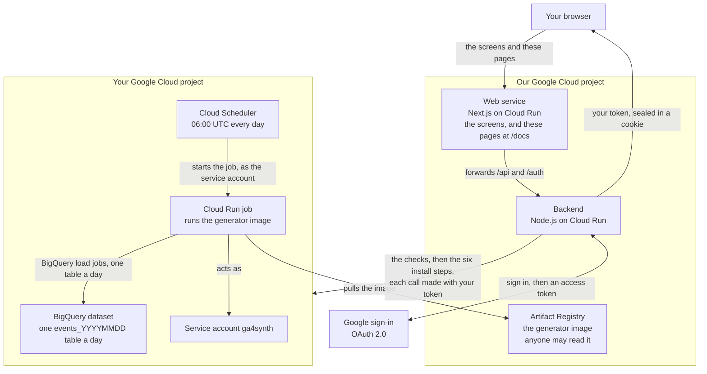

This page is for the curious and for the cautious. It shows every piece of the
tool, and every call it makes, so you can see exactly what touches your
Google Cloud project. A **Google Cloud project** is the box Google puts your
cloud resources and your bill in.

The short version: we host two small services, you sign in with Google, and
our backend uses your own sign-in to create things in your project. After
that we are out of the picture. The dataset and the daily refresh live in
your project and run on your own billing account.

## The diagram

Read it in three bands. The top is you and Google. The middle is our side,
which serves the pages and does the install. The bottom is your project,
which holds everything that is created and keeps running on its own.

## Our side

Two services and one image, all in a Google Cloud project of ours. **Cloud
Run** is Google's way of running a container, which is a packaged program.
Cloud Run offers two shapes, and the tool uses both: a **service**, which
answers web requests and waits for the next one, and a **job**, which runs
once, does its work and stops.

### The web service

A Next.js application on Cloud Run. Next.js is a web framework for
JavaScript. This service draws every screen you click through, and it serves
these documentation pages at `/docs`.

It is also the only address your browser ever talks to. Requests whose path
starts with `/api/` or `/auth/` are forwarded to the backend, and the answer
comes back through the web service. So the backend's cookie is a cookie of
the same site as the screens.

### The backend

A Node.js application on Cloud Run. Node.js runs JavaScript on a server. The
backend handles the sign-in, runs the checks, and performs the install steps.
It holds no database and writes nothing down about you.

### The generator image

The **generator** is the program that invents the traffic. It is written in
Python and it is called `ga4synth`.

It is packaged as a container image and stored in **Artifact Registry**,
Google's store for container images. **Cloud Build**, Google's build service,
builds the image from the generator's code and the tool's own configuration.
The repository it lands in is readable by anyone, on purpose: your project
has to pull the image, and it should not need a password from us to do it.
Nothing secret is in the image.

## Signing in with Google

Sign-in uses **OAuth 2.0**, the standard way to let one site act on your
behalf in another. The backend asks Google for three things:

| Scope | What it is for |
|---|---|
| `openid` | Confirms who you are |
| `email` | Your email address, which the screens show |
| `https://www.googleapis.com/auth/cloud-platform` | Permission to act in your Google Cloud projects, as you |

The third one is the large one, and it has to be, because the tool creates
real resources in your project. It gives the tool no more power than you
already have: every call it makes is checked against your own permissions by
Google.

Google answers with an **access token**, a short-lived key that stands for
your permission. The backend seals that token inside a cookie in your
browser, encrypted with AES-256-GCM, a standard cipher. Only our backend can
open it. We keep no copy. The token is in your browser and nowhere else.

Signing out ends it properly: the backend deletes the cookie and asks Google
to revoke the token, so it stops working everywhere at once. If you simply
close the tab instead, the token expires on its own. Google sets that expiry
when it issues the token, and the cookie is set to disappear at the same
moment.

## What the backend does in your project

Every call below is made with your access token, so Google treats it as a
call from you. One is the exception, and it is the last check in the table:
reading our own generator image needs no token at all, because the registry
it sits in is public.

### The checks, before anything is created

Nothing is created until these pass. They only read.

| What is checked | The Google service that is asked |
|---|---|
| The project exists, and your permissions on it | Cloud Resource Manager, which lists and describes projects |
| Billing is switched on | Cloud Billing, which holds the link between a project and a billing account |
| No organisation rule blocks the install | Org Policy, which holds the rules an organisation sets on its projects |
| Which Google services the project has switched on | Service Usage, which switches Google services on and off in a project |
| The generator image can be read | The image store itself, asked without any token |

If a check fails, the screen says which one, and what to change. If a check
cannot be run, it says so rather than guessing.

### The six install steps

They run in this order. Each one is safe to run again: if the thing already
exists, the step moves on.

1. **Switch on the services the install needs.** Through Service Usage:
   Cloud Run, BigQuery, IAM, and Cloud Resource Manager. Cloud Scheduler is
   added only if you asked for the daily refresh.
2. **Create the BigQuery dataset.** **BigQuery** is Google's data warehouse,
   and a **dataset** is a folder of tables inside it. This is the dataset
   that will look like a GA4 export.
3. **Create the service account, and give it its permissions.** A **service
   account** is an identity for a program rather than a person. This one is
   called `ga4synth`. It is granted two roles on the project, BigQuery Job
   User and Cloud Run Invoker, and `WRITER` on the dataset alone. So in
   BigQuery it can write into this one dataset and no other, and in the
   project it can start Cloud Run jobs, which is what lets the schedule run
   it. **IAM** is the Google service that holds identities and roles.
4. **Create the Cloud Run job.** It is named `ga4synth-` followed by a
   number, so one project can hold several installs side by side. The job
   runs the generator image, as the service account.
5. **Create the Cloud Scheduler job.** **Cloud Scheduler** is Google's
   alarm clock: it calls something on a timetable. This step is skipped
   unless you asked for the daily refresh.
6. **Start the first run.** This is the one that fills the history, so it is
   the long step. The progress you watch on screen is read back from your
   project, not from a record of ours.

## In your project, after the install

### The job that writes the data

The Cloud Run job runs the generator image, as the service account
`ga4synth`. The generator invents one day of traffic at a time and writes it
into the dataset as one table named `events_YYYYMMDD`, where the digits are
the date. It writes through **BigQuery load jobs**, BigQuery's way of taking
a file of rows into a table. A load replaces the table it writes, so running
a day again simply rewrites that day.

### The daily refresh

If you asked for it, Cloud Scheduler starts the Cloud Run job every day at
06:00 UTC, calling it as the service account. The schedule is written as
`0 6 * * *` in the UTC time zone, and you can change it later in your own
project.

Each daily run writes the last three days, not just yesterday. That is
deliberate. A run that fails, or a day that is missed, is written again the
next morning, so the dataset heals itself without anyone looking.

### All that is left of ours is the image

After the install our two services hold nothing and take no part. We have no
credentials on your project, no record of your install, and no way to reach
it. The refresh runs entirely inside your project, on your billing account.

One thing of ours is still used, once at the start of every run: the
generator image. Your job reads it from our public registry, the same
anonymous read anyone could make. That is the whole of the connection.

The other side of that is yours to act on: the install keeps costing until
you remove it. [How to remove an install](./how-to-remove.mdx) shows how,
and it takes a few minutes.
